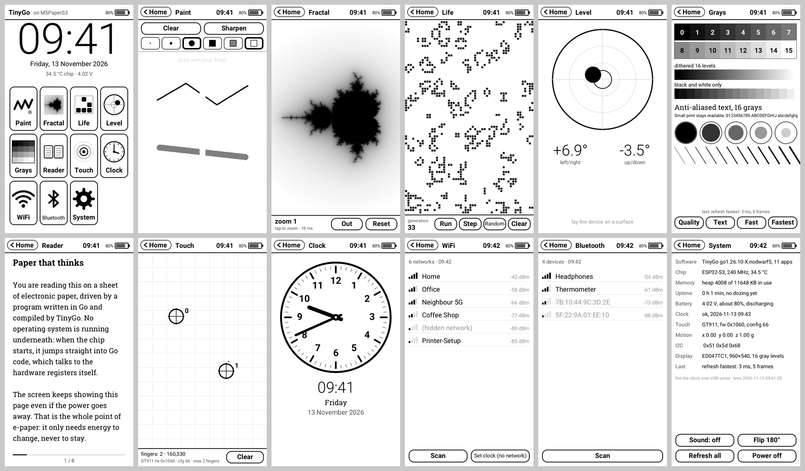

# TinyGo on the M5Stack PaperS3

Go on the M5Stack PaperS3 (ESP32-S3, 4.7" 960x540 e-paper, GT911 touch),
compiled with TinyGo 0.44 for the `esp32s3-generic` target and flashed over
the built-in USB port. Nothing from ESP-IDF or Arduino is used. Every
peripheral is driven from Go.



## Quick start

```sh
make launcher        # build + flash the launcher (home screen with 11 apps)
make launcher WIFI_SSID='My Network' WIFI_PASSWORD='secret'   # ... with WiFi for "Set clock"
make time            # set the board's clock from this PC
make shot            # save what is on the screen as papers3.png
make sim             # run the launcher on the PC, screenshots in sim-out/
make test            # host tests (simulated hardware)
```

`PORT=/dev/ttyACM1 make ...` if the board shows up elsewhere.

## Packages

| Package | What |
|---|---|
| `epd/` | ED047TC1 e-paper driver: 16 gray levels, 4 rotations, waveforms from M5GFX, change tracking (only changed pixels are driven). LCD_CAM in i8080 mode + GDMA shift each row out at 16 MHz. CKV/LE are produced by the LCD_CS signal, so row timing is exact. Implements the TinyGo `drivers.Displayer` interface. |
| `gt911/` | GT911 touch controller, 5 points, `touch.Pointer`. |
| `papers3/` | Board support: `Configure()`, `Display`, `ReadTouches`, RTC (`Now`, `SetTime`, BM8563), IMU (`ReadAccel`, `ReadGyro`, BMI270), `ReadBattery`, `ChipTemperature`, `Beep`, `SetLED`, `ScanI2C`. Power: `LightSleep`, `DeepSleep`, `PowerOff`, `PowerOffFor`, `Retained`/`SetRetained`, `USBHost` (see [Sleep and power](#sleep-and-power)). On a PC it is a simulator. |
| `psram/` | Sets up the 8 MB octal PSRAM (40 MHz) and maps it at 0x3D000000: `Init`, `Alloc`, `Bytes`, cache `Writeback`/`Invalidate`. TinyGo does not do this itself. |
| `radio/` | WiFi (`ScanWiFi`, `NetworkTime` = connect + DHCP + NTP) and Bluetooth LE (`ScanBLE`) on top of [espradio](https://github.com/tinygo-org/espradio) and [bluetooth](https://github.com/tinygo-org/bluetooth). See [WiFi and Bluetooth](#wifi-and-bluetooth). |
| `gfx/` | Anti-aliased drawing on 16 grays: text (`DrawText`, `Wrap`), circles, rings, lines, rounded rectangles, triangles, dithering. |
| `fonts/` | Roboto / Roboto Slab bitmap fonts with 4-bit coverage (18-40 px, plus 64 and 180 px digits), kept in flash. Generated by `cmd/fontgen`. |
| `ui/` | Small app framework (touch gestures, status header, buttons, refresh scheduling) plus the launcher and its apps. |
| `cmd/sim` | Runs the launcher with a simulated board and saves screenshots. |
| `cmd/fontgen` | TTF to bitmap font converter (host only, uses golang.org/x/image). |
| `tools/papers3.py` | Talks to the launcher over USB serial: set time, screenshot, tap, drag, open app, status. |

Examples: `examples/launcher` (the main program), `examples/hellodisplay`
(the snippet below), `examples/paint` (minimal finger painting), `examples/epdtest` (test pattern + bus timing),
`examples/touchtest` (I2C scan + touch log), `examples/bench` (row fill loop
benchmark), `examples/wifiscan` (WiFi networks on the serial port),
`examples/psramtest` (PSRAM pattern test and speed), `hello/` (serial hello world).

## The launcher

Home shows a big clock, the date, the chip temperature, the battery voltage and a
grid of apps. Tap **Home** in the header to come back.

| App | What it does |
|---|---|
| Paint | Finger painting in 3 pen sizes with black, dithered gray or white ink, drawn with fast partial updates. *Sharpen* runs a full quality update and *Clear* erases. |
| Fractal | Mandelbrot set in 16 dithered grays. Tap to zoom in 3x. Rendering takes ~1.5 s on the device. |
| Life | Conway's Game of Life, 54x81 cells. Each generation takes ~70 ms (only changed cells are driven). Tap or drag to edit while paused. A run stops by itself after 500 generations. |
| Level | Bubble level from the BMI270 accelerometer. |
| Grays | Display test: the 16 levels, gradients, text and shapes. Buttons redraw everything with each waveform. |
| Reader | Paginated text with a serif font (a short built-in guide). Tap right or left to turn the page. |
| Touch | Shows up to 5 fingers with their IDs and coordinates. |
| Clock | Analog clock face, redrawn every minute. |
| WiFi | Lists the networks around (scans when opened, ~5 s). *Set clock* connects to the network built in with `WIFI_SSID`/`WIFI_PASSWORD`, gets the time from pool.ntp.org, sets the RTC (local time, see `ui.Zone`) and disconnects (~5 s). |
| Bluetooth | Lists the Bluetooth LE devices that advertise nearby (listens 8 s). |
| System | Board status (memory, battery, RTC, IMU, I2C devices, last refresh, time spent dozing) and settings: sound, flip 180°, full refresh, power off. |

The header clock and battery update once a minute. Every hour the whole
screen gets one full refresh to clear ghosting.

On battery the launcher dozes: after 15 s without a touch it puts the chip
into light sleep, up to 2 s at a time (and until the next minute for the
clock); a touch wakes it. The picture stays on the e-paper. It does not doze
with a computer on the USB port, with the radio on, or in Life (running) and
Level. The System app shows how much of the time it dozed and how many
dozes a touch ended.

### Serial commands

The launcher reads commands, one per line, on the USB serial port.
`tools/papers3.py` wraps them:

```sh
tools/papers3.py time                  # set the RTC to local time
tools/papers3.py shot screen.png       # frame buffer -> PNG (about 1 s)
tools/papers3.py tap 270 480           # portrait coordinates
tools/papers3.py drag 80 400 460 520
tools/papers3.py open fractal          # or home, paint, life, ...
tools/papers3.py status
```

More commands (type them in `make monitor`): `sleep MS` (light sleep),
`deepsleep S`, `sleepinfo`, `dozetest N` (doze N times although USB is
connected), `epd [quality|text|fast|fastest]` (full-screen refresh with
timing statistics).

Opening the port with default settings is safe. Releasing DTR/RTS is the
USB-Serial-JTAG reset sequence, and the board reboots.

## Display modes and timing (measured on the device)

| Mode | Full screen | Notes |
|---|---|---|
| `ModeQuality` | 597 ms, 49 frames | 16 levels. Flashes black/white first. |
| `ModeText` | 560 ms, 46 frames | 16 levels, crisp text. Flashes. |
| `ModeFast` | 100 ms, 8 frames | Black/white only (levels < 8 become black). No flash, light ghosting. |
| `ModeFastest` | 63 ms, 5 frames | Like fast, with more ghosting. |

`Update(mode)` redraws the whole screen. `UpdateRect` redraws one area.
`Refresh(mode)` drives only the pixels that changed since they were last
sent. Even flashing modes only flash those pixels.

A frame takes ~12 ms: 540 rows of 248 bytes at 16 MHz (20.5 µs per row, 15.5
of them on the bus), then a pause of at least 1 ms. M5GFX lets other tasks
run in that pause (`vTaskDelay(1)`); here other goroutines run in it, so the
radio drivers keep working during an update. Building a row from the 4-bit
frame buffer has to finish within the ~15.5 µs the previous row needs on the
bus; it takes up to 14 µs (branch-free 16-pixel loop). In the fast modes about
50 rows of the first frame are late (cold caches). Rows that are late only
stretch the gap between rows, because the gate (CKV) and latch (LE) signals
come from the LCD hardware.

## Writing your own program

```go
package main

import (
	"time"

	"tiny-m5papers3/epd"
	"tiny-m5papers3/fonts"
	"tiny-m5papers3/gfx"
	"tiny-m5papers3/papers3"
)

func main() {
	papers3.Configure()
	d := papers3.Display // 540x960 portrait, 0 = black ... 15 = white
	gfx.DrawText(d, fonts.SansBold40, 40, 200, "Hello, PaperS3!", gfx.Black)
	gfx.FillCircle(d, 270, 500, 120, gfx.Mid)
	d.Update(epd.ModeQuality)
	for {
		for _, t := range papers3.ReadTouches(nil) {
			gfx.FillCircle(d, float32(t.X), float32(t.Y), 6, gfx.Black)
		}
		d.Refresh(epd.ModeFast)
		time.Sleep(20 * time.Millisecond)
	}
}
```

To add an app to the launcher, implement `ui.App` (`Title`, `Icon`, `Start`,
`Event`, `Tick`) and add it in `ui/apps.go`. It shows up in `make sim` right
away.

## Hardware notes

| Function | GPIO |
|---|---|
| EPD D0-D7 | 6, 14, 7, 12, 9, 11, 8, 10 |
| EPD CL / LE / OE / SPH | 16 / 15 / 45 / 13 |
| EPD SPV / CKV / PWR | 17 / 18 / 46 |
| I2C SDA / SCL (touch 0x5D, RTC 0x51, IMU 0x68) | 41 / 42 |
| Touch INT | 48 |
| Buzzer / LED | 21 / 0 |
| Battery ADC (x2 divider) / charging (low) | 3 / 4 |
| SD card SCK / MOSI / MISO / CS | 39 / 38 / 40 / 47 |
| Power hold (pulsed to switch off) | 44 |

Memory: the frame buffer (259 KB, 4 bits per pixel) and the change map
(65 KB) live in the PSRAM (package `psram`), so the 292 KB heap in internal
RAM is nearly free: 18 KB in use on the Home screen, ~185 KB once WiFi and
Bluetooth are on, ~206 KB after the first WiFi connection (network stack). The PSRAM runs at 40 MHz (32 MB/s read); the refresh loop
has the cache preload the next row, which keeps full-screen updates within
1% of internal RAM (large partial updates ~8% slower; 80 MHz would need the
MSPI timing tuning that ESP-IDF does, not done). Fonts and code run from
flash.

Known limitations:
- The battery voltage uses TinyGo's uncalibrated ADC conversion, so the
  percentage is rough.
- The IMU axis directions on the Level screen were not checked by tilting a
  real device.
- `PowerOff` follows M5Unified (5 pulses on GPIO44) but has not been tried on
  battery power; neither has `PowerOffFor`.
- Waking from light sleep by touch is implemented (GT911 INT, GPIO48) but
  was not tried with a finger yet: the System app's "touch wakes" count
  shows whether it works. Doze wakes every 2 s anyway.

## WiFi and Bluetooth

Package `radio` wraps espradio (WiFi/BLE driver blobs from ESP-IDF, run by
TinyGo) and the TinyGo bluetooth package. Measured on the PaperS3:

- WiFi scan: 15-25 networks in ~4 s. Bluetooth LE scan: 20-30 devices in 8 s.
- espradio v0.5.0 has no WiFi/Bluetooth coexistence, so the radio does one
  thing at a time. Bluetooth has to start before WiFi is started for the
  first time (started later, it hears nothing and WiFi stops finding
  networks too), so the first radio call starts both (~1 s). A Bluetooth
  scan stops WiFi (and its connection); the next WiFi call starts it again.
- The drivers need ~165 KB of internal RAM: a 96 KB memory arena (WiFi and
  Bluetooth use 58 KB of it; the 48 KB default is too small for both), a
  receive ring and task stacks. Once on, the radio stays on until the
  next reset (the drivers cannot switch it off), and the launcher no longer
  dozes.
- TinyGo's garbage collector is conservative and scans the drivers' arena,
  which keeps pointers into the stack of whichever goroutine called the
  driver. The launcher therefore makes all radio calls from one long-lived
  goroutine; with a new goroutine per call, ~12 KB stayed allocated after
  each scan until the heap ran out.
- *Set clock* (`radio.NetworkTime`: connect, DHCP, NTP) takes 4-5 s, then
  the board leaves the network. An access point keeps the session of a
  station that just goes away (a reset) for a few minutes, and the station's
  next WPA handshake times out; `NetworkTime` tries up to 3 times (12 s per
  failed try).
- espradio keeps its network stack across connections and only asks for a
  new DHCP lease. Once lneto's stack has an address it drops broadcast
  packets, and routers broadcast DHCP replies, so `radio` clears the address
  before each connection (otherwise every connection after the first timed
  out in DHCP).
- espradio times its drivers with `time.Now`, so setting the clock while the
  radio is on stalls them (clock set back) or fires their timers early (set
  forward). Once the radio is on, `papers3.SetTime` leaves `time.Now` alone
  and moves only `papers3.Now` (`papers3.SteadyClock`, set by package `ui`).
  Use `papers3.Now` for the time of day.

For *Set clock*, build with your network:

```sh
make launcher WIFI_SSID='My Network' WIFI_PASSWORD='secret'
# or: tinygo flash -target esp32s3-generic -ldflags "-X 'main.wifiSSID=My Network' -X 'main.wifiPassword=secret'" ./examples/launcher
```

The time zone is `ui.Zone` (default UTC+2 with EU summer time; change it in
`ui/radio.go`).

## Sleep and power

| Function | What | Status |
|---|---|---|
| `papers3.LightSleep(d)` | CPU stopped, RAM and display kept; wakes after d or on a touch (GT911 INT). The clock is corrected. | timer wake verified; touch wake not yet tried |
| `papers3.DeepSleep(d)` | Chip off except the RTC; restarts the program after d (`GetStatus().Wake == WakeTimer`). `SetRetained`/`Retained` keep 2 words. Touch cannot wake it: GPIO48 is not an RTC pin. | verified (5 s) |
| `papers3.PowerOff()` | Switches the board off (power button to start again). On USB power it stays on. | not tried on battery |
| `papers3.PowerOffFor(d)` | Off, and the RTC switches it on again after d (`WakeAlarm`). On USB power: deep sleep instead. | not tried on battery |

While the chip sleeps, the USB serial port does not answer; `papers3.USBHost()`
tells whether a computer is connected (the launcher only dozes without one).
Every sleep arms the RTC watchdog first: if the chip does not come back, it
resets about 12% + 2 s after the planned wake time instead of hanging.

## Licenses

Waveform tables from LovyanGFX as shipped in
[M5GFX](https://github.com/m5stack/M5GFX) (FreeBSD license,
`epd/LICENSE-LovyanGFX`). Fonts: Roboto and Roboto Slab, Apache License 2.0
(`fonts/LICENSE-fonts`). The BMI270 config blob comes with the TinyGo driver
(Bosch license).
